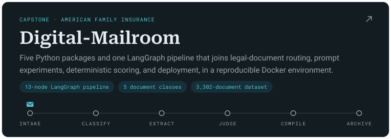
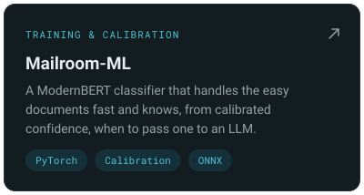
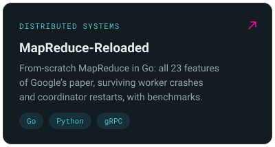
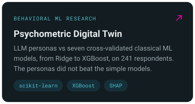
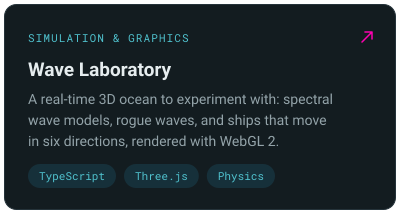
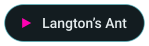
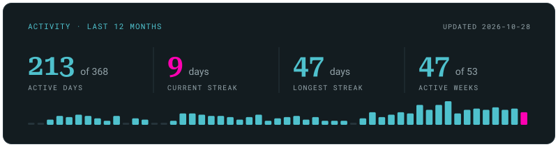

  <picture>
    <source media="(max-width: 640px)" srcset="assets/header-compact.svg" />
    
  </picture>

  M.S. candidate in Psychology: Data Science in Human Behavior at UW–Madison.

---

  I build AI systems from start to finish: multi-agent document pipelines, fine-tuned and calibrated transformers, LLM evaluation harnesses, and behavioral prediction models.

  <picture>
    <source media="(max-width: 640px)" srcset="assets/badges/uw-madison-compact.svg" />
    
  </picture>

  
  
  
  

## Featured work

  <a href="https://github.com/LLM-Mailroom-Services/Digital-Mailroom">
    <picture>
      <source media="(max-width: 640px)" srcset="assets/cards/digital-mailroom-compact.svg" />
      
    </picture>
  </a>

  <a href="https://github.com/LLM-Mailroom-Services/mailroom-ml"><picture><source media="(max-width: 640px)" srcset="assets/cards/mailroom-ml-compact.svg" /></picture></a>
  <a href="https://github.com/Exios66/MapReduce-Reloaded"><picture><source media="(max-width: 640px)" srcset="assets/cards/mapreduce-reloaded-compact.svg" /></picture></a>
  <a href="https://github.com/Exios66/psych755-jjb"><picture><source media="(max-width: 640px)" srcset="assets/cards/psychometric-digital-twin-compact.svg" /></picture></a>
  <a href="https://github.com/Exios66/wave-laboratory"><picture><source media="(max-width: 640px)" srcset="assets/cards/wave-laboratory-compact.svg" /></picture></a>

  <b>Try it in the browser</b> 
  
  
  
  
  

  
    Also:
    <a href="https://github.com/Exios66/mailroom-reloaded">Mailroom Reloaded</a> ·
    <a href="https://github.com/Exios66/Mailroom-Corpus-EDA">Mailroom-Corpus-EDA</a> ·
    <a href="https://github.com/Exios66/RVL-CDIP-Classifier">RVL-CDIP-Classifier</a> ·
    <a href="https://github.com/Exios66/aeroglobe">AeroGlobe</a> ·
    <a href="https://github.com/Exios66/truth-deception-architecture">Truth &amp; Deception study</a> ·
    <a href="https://github.com/Exios66/degen-llms">The Mandalay Bay</a> ·
    <a href="https://github.com/Exios66/langtons-ant">Langton’s Ant</a>
     
    <a href="https://exios66.github.io/resume/projects/">All projects with case studies →</a>
  

## Toolbox

  
  
  
  
  
  
  
  

<table align="center">
  <tr><td><b>Languages &amp; data</b></td><td><code>Python</code> · <code>R</code> · <code>SQL</code> · <code>TypeScript</code> · <code>MATLAB</code></td></tr>
  <tr><td><b>Machine learning</b></td><td><code>PyTorch</code> · <code>scikit-learn</code> · <code>Hugging Face</code> · <code>fine-tuning</code> · <code>calibration</code> · <code>SHAP</code></td></tr>
  <tr><td><b>AI engineering</b></td><td><code>LangGraph</code> · <code>multi-agent</code> · <code>LLM evals</code> · <code>vLLM</code> · <code>Ollama</code> · <code>OpenRouter</code> · <code>FastAPI</code></td></tr>
  <tr><td><b>Engineering &amp; cloud</b></td><td><code>Docker</code> · <code>gRPC</code> · <code>Spark</code> · <code>pytest</code> · <code>Quarto</code> · <code>AWS</code> · <code>Azure</code> · <code>GCP</code></td></tr>
</table>

## Background

<table align="center">
  <tr>
    <td valign="top"><b>Education</b></td>
    <td>M.S. candidate, Psychology: Data Science in Human Behavior, UW–Madison (expected December 2026). B.S. Psychology, neuroscience concentration, UW–Parkside (2025).</td>
  </tr>
  <tr>
    <td valign="top"><b>Research</b></td>
    <td>Cognitive neuroscience lab at UW–Parkside: EEG, and a study of truth, deception, and cognitive workload, presented at the 2025 Midwestern Psychological Association conference.</td>
  </tr>
  <tr>
    <td valign="top"><b>Before grad school</b></td>
    <td>Five years in high-volume logistics, working on quality assurance, documentation, and process improvement. It is why I care about error rates, reproducibility, and cost as much as accuracy.</td>
  </tr>
</table>

## Contact

  

  
  
  
  
  

## Activity

<!-- The #gh-*-mode-only suffixes follow GitHub's own theme setting (including "Sync with system"). -->

  <picture>
    <source media="(max-width: 640px)" srcset="assets/stats-compact.svg" />
    
  </picture>

 

Don't hesitate to reach out, I would love to connect with likeminded individuals!

*As always, wishing you the godspeed my friend...*

