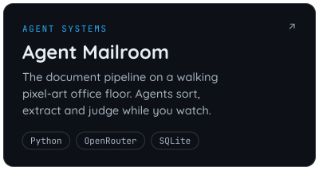
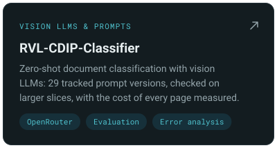
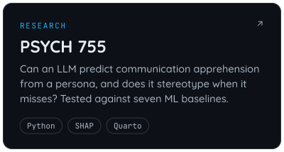
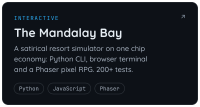
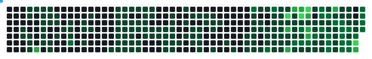

  

  I build and evaluate LLM systems: document-intelligence pipelines, 
  multi-agent workflows, and the measurement that shows whether they work.

  <a href="#featured-work">Work</a> &nbsp;·&nbsp;
  <a href="#toolbox">Toolbox</a> &nbsp;·&nbsp;
  <a href="#contact">Contact</a>

## Featured work

  <a href="https://github.com/LLM-Mailroom-Services/Digital-Mailroom">
    <picture>
      <source media="(max-width: 640px)" srcset="assets/cards/digital-mailroom-compact.svg" />
      
    </picture>
  </a>
  
  
  
  

## Toolbox

<table align="center">
  <tr><td><b>Languages</b></td><td><code>Python</code> · <code>R</code> · <code>TypeScript</code> · <code>JavaScript</code></td></tr>
  <tr><td><b>LLMs &amp; agents</b></td><td><code>OpenRouter</code> · <code>LangGraph</code> · <code>Hugging Face</code> · <code>vLLM</code></td></tr>
  <tr><td><b>ML &amp; evaluation</b></td><td><code>scikit-learn</code> · <code>XGBoost</code> · <code>SHAP</code> · <code>Braintrust</code></td></tr>
  <tr><td><b>Data &amp; documents</b></td><td><code>SQLite</code> · <code>Tesseract OCR</code> · <code>Quarto</code></td></tr>
  <tr><td><b>Front end</b></td><td><code>React</code> · <code>Phaser</code></td></tr>
</table>

## Contact

<table align="center">
  <tr>
    <td valign="middle">
      
    </td>
    <td valign="middle">
      <b>Email</b> 
      <a href="mailto:jackjburleson@proton.me">jackjburleson@proton.me</a>
        
      <b>LinkedIn</b> 
      <a href="https://linkedin.com/in/jackjburleson">in/jackjburleson</a>
        
      <b>Instagram</b> 
      <a href="https://instagram.com/jackjburleson">@jackjburleson</a>
    </td>
  </tr>
</table>

## Activity

<picture>
  <source media="(prefers-color-scheme: dark)" srcset="assets/snake-dark.svg" />
  <source media="(prefers-color-scheme: light)" srcset="assets/snake.svg" />
  
</picture>

<!-- my-badges start -->
<!-- my-badges end -->
